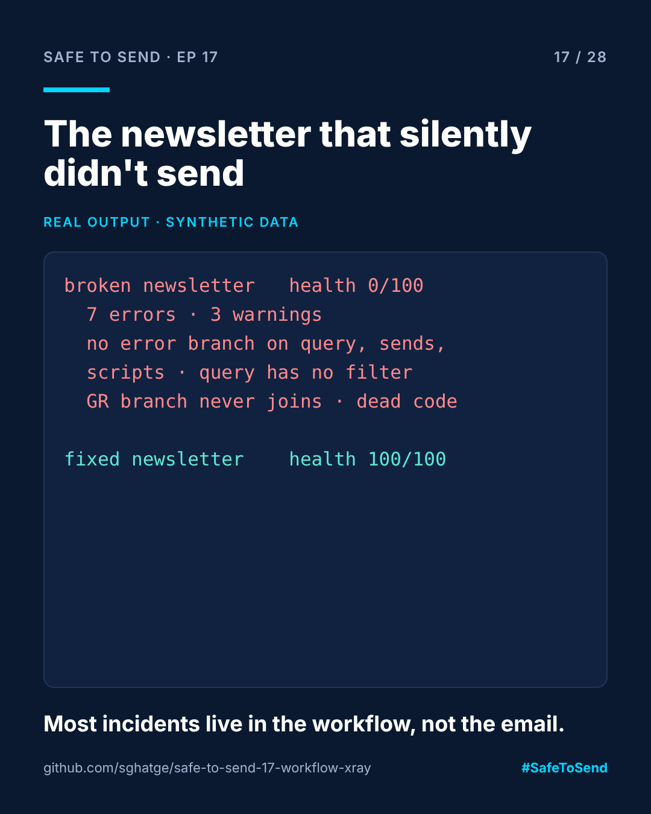

# safe-to-send-17 · Workflow X-Ray



**Safe to Send · Episode 17** — a 28-day learn-in-public series on governing AI in CRM operations.

> Most campaign incidents aren't in the email. They're in the workflow behind it.

## The real-world scenario

A weekly newsletter workflow has run for months. Then the audience query times out at 06:00 on a Monday. There is no error branch, so nothing alerts anyone. The Greek send never joins back, so the stats step never runs. Nobody notices until a market asks where their newsletter went.

## Run it

```bash
python workflow_xray.py examples/newsletter_broken.xml
python workflow_xray.py examples/newsletter_fixed.xml --diagram
```

## Real example output

```
Weekly newsletter (broken, synthetic): health 0/100, 9 activities
  error   audience       query has no error branch: a failure alerts nobody
  error   audience       query has no filter: full recipient table scan
  error   gr_send        dead end: no outgoing transition, the run just stops
  error   gr_send        delivery has no error branch: ...
  error   hr_send        delivery has no error branch: ...
  error   old_cleanup    script has no error branch: ...
  error   report         script has no error branch: ...
  warning audience       query has no limit
  warning fork           fork branch via 'gr_send' never reaches a join
  warning old_cleanup    unreachable from start (dead code)

Weekly newsletter (fixed, synthetic): health 100/100, 9 activities
```

`--diagram` prints a Mermaid flowchart with error branches drawn as dotted lines, ready to paste into a GitHub README or a ticket.

## The checks

| Check | Level |
|---|---|
| Start and end activities exist | error |
| Dead end (non-end activity with no way out) | error |
| Query, delivery or script with no error branch | error |
| Query with no filter | error |
| Query with no limit | warning |
| Fork branch that never reaches a join | warning |
| Activity unreachable from start | warning |

## Important

The XML here is a **simplified teaching format**, not Adobe Campaign's package export. The checks are the transferable part. A fuller analyser for real v8 exports is in progress as `acc-workflow-intelligence`.

MIT · [Sangram Ghatge](https://www.linkedin.com/in/sangram-g-2369705b) · #SafeToSend
